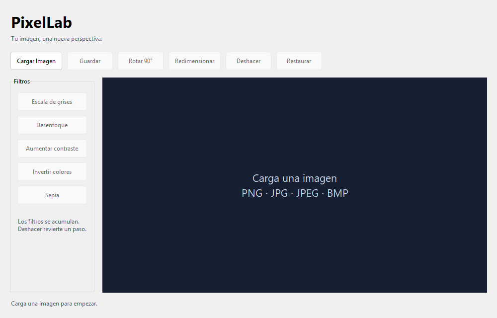
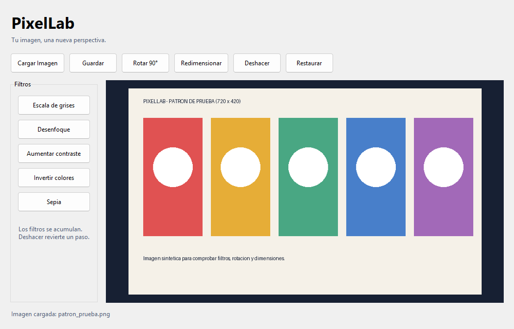
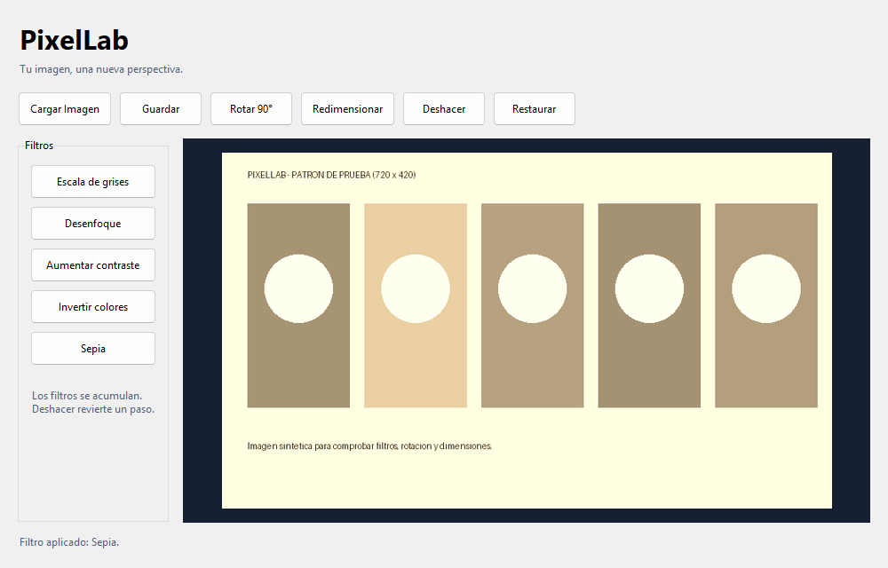
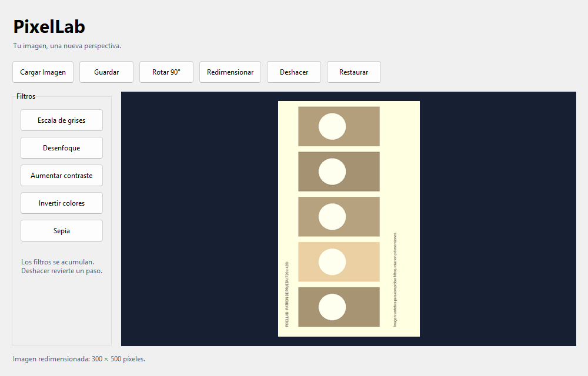

# PixelLab

## 1. Nombre del proyecto

**PixelLab**: editor de imágenes de escritorio desarrollado en Python con Tkinter y Pillow, como Parcial Integrador de Programación Orientada a Objetos.

Repositorio: https://github.com/areizaanderson1779-coder/PixelLab

Documentación complementaria:
- [Informe técnico](docs/INFORME_TECNICO.md)
- [Diagramas (clases y secuencia)](docs/DIAGRAMAS.md)

---

## 2. Descripción del problema

Para hacer ediciones sencillas sobre una imagen, como pasarla a escala de grises, rotarla, cambiarle el tamaño o volver atrás, a menudo hay que recurrir a programas extensos. PixelLab ofrece una herramienta de escritorio liviana para esas operaciones básicas, con vista previa y la opción de deshacer.

El proyecto también responde a un objetivo académico: organizar la solución con Programación Orientada a Objetos. La lógica de edición está separada de la interfaz, los filtros comparten un contrato abstracto común y el estado de la imagen está protegido mediante encapsulamiento y validaciones.

---

## 3. Objetivos

### Objetivo general
Desarrollar una aplicación de escritorio en Python para la edición básica de imágenes, con interfaz gráfica, usando la Programación Orientada a Objetos como paradigma principal.

### Objetivos específicos
- Modelar los filtros con una clase abstracta (`Filtro`) y cinco subclases que implementen de forma distinta la operación `aplicar()`.
- Encapsular en `EditorImagen` el estado de la imagen, el historial de cambios y las validaciones.
- Construir con Tkinter una ventana (`VentanaPrincipal`) que delegue la lógica de edición al modelo.
- Manejar los errores previsibles sin perder la imagen con la que se está trabajando.
- Verificar el funcionamiento con pruebas automatizadas del modelo y una prueba de integración de la interfaz.

---

## 4. Funcionalidades

| # | Funcionalidad | Detalle |
|---|---|---|
| 1 | Abrir imagen | Formatos PNG, JPG, JPEG y BMP. Corrige la orientación EXIF y muestra una vista previa. |
| 2 | Aplicar filtros | Cinco filtros acumulativos: **Escala de grises**, **Desenfoque** (gaussiano, radio fijo 2), **Aumentar contraste** (factor fijo 1.5), **Invertir colores** y **Sepia**. Conservan la transparencia. |
| 3 | Rotar 90° | Rota en sentido antihorario sin recortar la imagen. |
| 4 | Redimensionar | Cambia el ancho y el alto reales de la imagen. Cada valor debe estar entre 1 y 10000, con un máximo de 25.000.000 de píxeles en total. |
| 5 | Deshacer | Revierte cambios sucesivos (filtros, rotaciones, redimensionados y restauraciones). |
| 6 | Restaurar | Vuelve a la imagen original de la última carga. Esta acción también se puede deshacer. |
| 7 | Guardar / exportar | Formatos PNG, JPEG y BMP. PNG conserva la transparencia. JPEG y BMP se componen sobre fondo blanco si hay transparencia. JPEG se guarda con calidad 95. |
| 8 | Mensajes de error | Los errores previsibles se muestran en un cuadro de diálogo; las entradas inválidas comprobadas conservan la imagen anterior. |

La vista previa se adapta al tamaño de la ventana trabajando sobre una copia, de modo que **no reduce la imagen que se guarda**.

### Limitaciones conocidas
- No existe la opción de rehacer, ni capas, recorte, filtro de brillo, deslizadores de parámetros o procesamiento por lotes.
- No hay base de datos y la sesión no se conserva al cerrar la aplicación.
- No se avisa de cambios sin guardar al cerrar la aplicación o al cargar otra imagen. Cargar una imagen nueva vacía el historial.
- El historial guarda copias completas de la imagen, por lo que consume memoria.
- Las operaciones se ejecutan en el hilo de Tkinter, así que con imágenes grandes la ventana puede pausarse un momento.
- Redimensionar **no** conserva automáticamente la proporción.
- Guardar no cambia la imagen original que usa **Restaurar**.

---

## 5. Tecnologías utilizadas

| Tecnología | Tipo | Uso en PixelLab |
|---|---|---|
| Python 3.10 o superior | Lenguaje | Toda la aplicación. |
| Tkinter / ttk | Biblioteca estándar | Ventana, botones, lienzo, diálogos de archivos y números, y mensajes de error. |
| Pillow (`Pillow>=10.0.0`) | Biblioteca externa (única dependencia) | Carga, filtros, rotación, redimensionado, exportación y vista previa (`ImageTk`). |
| unittest / unittest.mock | Biblioteca estándar | Pruebas del modelo e integración de la interfaz. |
| Git y GitHub | Control de versiones | Historial y publicación del proyecto. |

Entorno en el que se verificó el proyecto (16 de noviembre de 2026): Windows, Python 3.14.10 y Pillow 13.0.0.

---

## 6. Instalación

**Requisitos:** Python 3.10 o superior, con Tkinter disponible.

1. Clonar el repositorio y entrar en la carpeta del proyecto:

```bash
git clone https://github.com/areizaanderson1779-coder/PixelLab.git
```

```bash
cd PixelLab
```

2. Instalar la dependencia desde la raíz del proyecto (la carpeta donde está `requirements.txt`):

```bash
pip install -r requirements.txt
```

Alternativa, si `pip` no apunta al Python correcto:

```bash
python -m pip install -r requirements.txt
```

3. Comprobar que Tkinter está disponible (debe abrirse una pequeña ventana de prueba):

```bash
python -m tkinter
```

> Tkinter **no** se instala con pip. Está disponible en la instalación habitual de Python para Windows cuando se incluye el componente Tcl/Tk. En algunas distribuciones de Linux es necesario instalar el paquete del sistema `python3-tk`.

---

## 7. Ejecución

Desde la raíz del proyecto:

```bash
python main.py
```

### Pruebas

Pruebas del modelo (18 pruebas):

```bash
python -m unittest discover -s tests -v
```

Prueba de integración de la interfaz (requiere un escritorio gráfico):

```bash
python tests/verificar_interfaz.py
```

Generación de capturas de la ventana:

```bash
python tests/verificar_interfaz.py --capturas
```

> La generación de capturas se verificó en Windows con Pillow 13.0.0. No se garantiza en otras plataformas ni en todas las versiones de Pillow. Esto no afecta la ejecución normal de la aplicación.

---

## 8. Manual de usuario

### 8.1 Ventana inicial
Al ejecutar `python main.py` se abre la ventana **PixelLab**. La barra superior tiene los botones **Cargar Imagen**, **Guardar**, **Rotar 90°**, **Redimensionar**, **Deshacer** y **Restaurar**. A un lado está el panel con los cinco filtros, en el centro el área de vista previa y abajo una etiqueta de estado. Mientras no haya una imagen cargada, los botones de edición permanecen deshabilitados.



### 8.2 Cargar una imagen
1. Pulse **Cargar Imagen**.
2. Seleccione un archivo PNG, JPG, JPEG o BMP.
3. La imagen aparece en la vista previa y se habilitan los botones de edición.

Si el archivo no es válido, aparece un mensaje de error y se mantiene la imagen anterior, si había una.



### 8.3 Aplicar filtros
Pulse cualquier filtro del panel lateral. Los filtros se **acumulan**: cada uno se aplica sobre el resultado anterior.



### 8.4 Rotar
Pulse **Rotar 90°**. La imagen gira 90° en sentido antihorario y el lienzo se amplía para que no se recorte.

### 8.5 Redimensionar
1. Pulse **Redimensionar**.
2. Escriba el **ancho** y confirme. Luego escriba el **alto** y confirme. Cada valor debe estar entre 1 y 10000.
3. Si cancela cualquiera de los dos diálogos, la imagen no cambia.

El ancho y el alto son independientes, así que la proporción no se conserva automáticamente. El total no puede superar 25.000.000 de píxeles.



### 8.6 Deshacer y restaurar
- **Deshacer** revierte el último cambio y puede usarse varias veces seguidas. Si no hay cambios, muestra el mensaje *"No hay cambios para deshacer."*
- **Restaurar** vuelve a la imagen original de la última carga. Si se arrepiente, puede deshacer la restauración.

### 8.7 Guardar
1. Pulse **Guardar**.
2. Elija la carpeta, el nombre y la extensión: `.png`, `.jpg`, `.jpeg` o `.bmp`.
3. La imagen se guarda con su resolución real, no con el tamaño de la vista previa.

### 8.8 Ejemplo de demostración
El proyecto incluye `recursos/patron_prueba.png`, un **patrón sintético de colores de 720×420 píxeles**. No es una fotografía: fue creado para comprobar los filtros, la orientación y las dimensiones.

1. Ejecute `python main.py`.
2. Cargue `recursos/patron_prueba.png`.
3. Aplique **Sepia**.
4. Pulse **Rotar 90°**. La imagen pasa a 420×720.
5. Pulse **Redimensionar** e indique ancho `300` y alto `500`.
6. Pulse **Deshacer** para comprobar que se recupera el estado anterior.
7. Guarde el resultado como PNG.

Las capturas de este manual son capturas reales de la ventana de Tkinter con este patrón cargado.

---

## 9. Estructura del proyecto

```
PixelLab/
├── .gitignore
├── main.py                      # Punto de entrada: crea VentanaPrincipal y ejecuta mainloop()
├── README.md                    # Este documento
├── requirements.txt             # Dependencia externa: Pillow>=10.0.0
├── modelos/                     # Lógica del dominio (no depende de Tkinter)
│   ├── __init__.py
│   ├── editor.py                # EditorImagen: estado, historial, validaciones, carga y exportación
│   └── filtros.py               # Filtro (abstracta) y sus cinco subclases
├── interfaz/                    # Presentación
│   ├── __init__.py
│   └── ventana_principal.py     # VentanaPrincipal (tk.Tk): controles, eventos y vista previa
├── recursos/
│   └── patron_prueba.png        # Patrón sintético de prueba (720×420)
├── tests/
│   ├── test_editor.py           # 18 pruebas del modelo (EditorImagen y filtros)
│   └── verificar_interfaz.py    # Integración con Tkinter real y generación de capturas
└── docs/
    ├── INFORME_TECNICO.md       # Informe técnico
    ├── DIAGRAMAS.md             # Diagramas de clases y de secuencia (Mermaid)
    └── imagenes/                # Capturas reales de la aplicación
        ├── 01_inicio.png
        ├── 02_imagen_cargada.png
        ├── 03_filtro_sepia.png
        └── 04_redimensionada.png
```

**Responsabilidades:**
- `modelos/` contiene toda la lógica de edición: filtros, historial, rotación, redimensionado, carga y exportación.
- `interfaz/` muestra la imagen y traduce las acciones del usuario en llamadas al modelo. No contiene lógica de edición.
- `main.py` solo arranca la aplicación. Importarlo no abre la ventana, porque el arranque está dentro de `if __name__ == "__main__":`.
- `tests/` comprueba el modelo y la integración con la interfaz.

---

## 10. Autores

- **Anderson Areiza**: areizaanderson1779@gmail.com
- **Cristian Sarmiento**
- **Yeyner Florez**

Proyecto desarrollado para el Parcial Integrador de Programación Orientada a Objetos.
