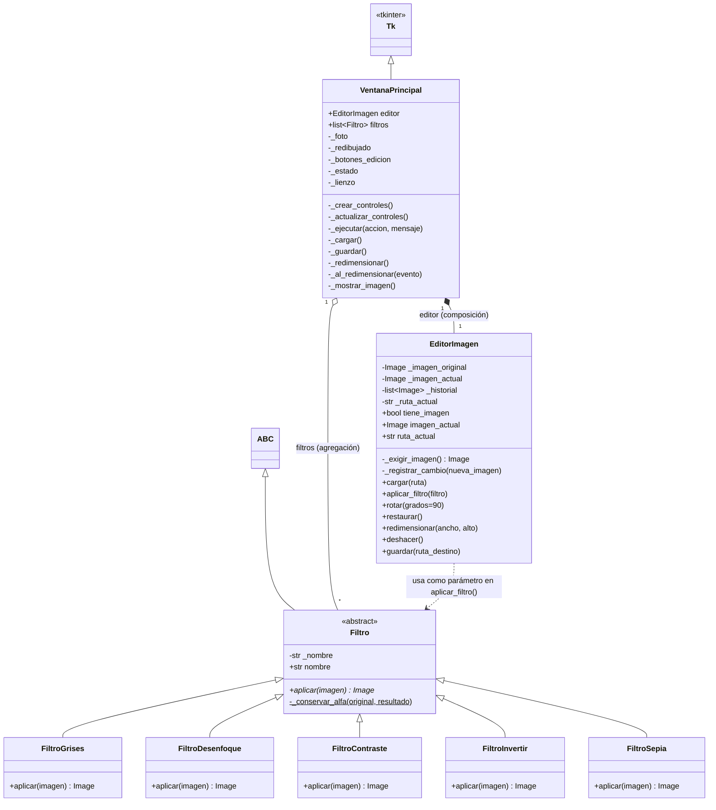
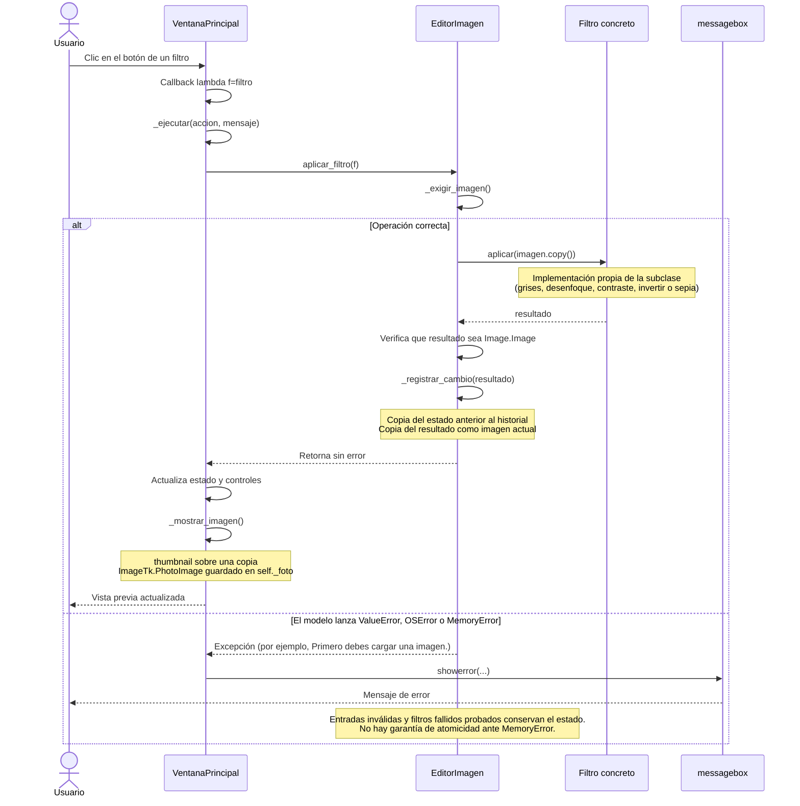
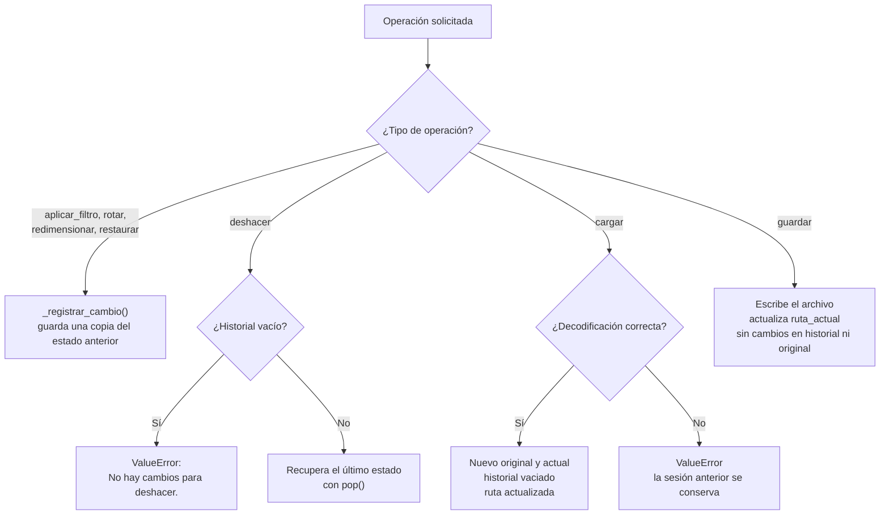
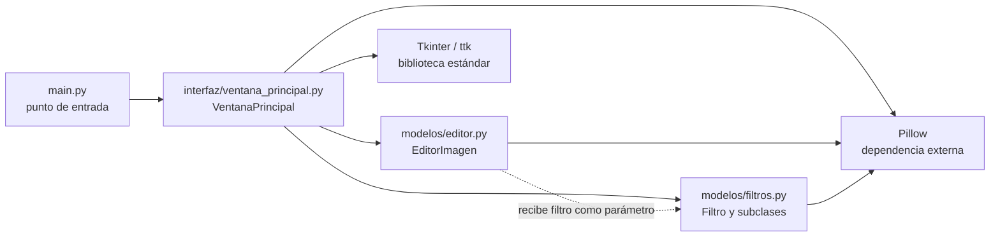

# Diagramas – PixelLab

Los diagramas están escritos en **Mermaid**, que GitHub muestra directamente. Solo incluyen las clases y relaciones que existen en el código.

Volver al [README](../README.md) · Ver el [Informe técnico](INFORME_TECNICO.md)

---

## 1. Diagrama de clases

### Lectura del diagrama

| Símbolo | Relación | En PixelLab |
|---|---|---|
| `<\|--` | Herencia | Los cinco filtros heredan de `Filtro`. `Filtro` hereda de `ABC`. `VentanaPrincipal` hereda de `tk.Tk`. |
| `*--` | Composición | `VentanaPrincipal` crea y administra su propio `EditorImagen`. |
| `o--` | Agregación | `VentanaPrincipal` mantiene una lista de filtros que puede recibir ya creados desde fuera. Con `filtros=None`, crea los cinco incluidos. |
| `..>` | Dependencia de uso | `EditorImagen` recibe un `Filtro` solo durante la llamada a `aplicar_filtro()` y **no** lo almacena. |

Notas:
- Los signos de visibilidad representan la intención del diseño: en Python `_` es una convención, no una restricción de acceso.
- `aplicar(imagen)*` es abstracto en `Filtro` y cada subclase lo implementa. `_conservar_alfa` es estático (`$`).
- `nombre`, `tiene_imagen`, `imagen_actual` y `ruta_actual` son **propiedades de solo lectura** (`@property` sin setter). `imagen_actual` devuelve una copia.
- `Image` corresponde a `PIL.Image.Image`. Las imágenes y la ruta del editor pueden ser `None` mientras no se haya cargado nada.
- Los cinco filtros no añaden atributos propios: solo implementan `__init__()`, que llama a `super().__init__("<nombre>")`, y `aplicar()`.

---

## 2. Diagrama de secuencia: aplicar un filtro

Aclaraciones:
- El editor llama a `aplicar()` de forma **polimórfica**: no sabe qué subclase recibe ni usa `if` por tipo.
- Desde la interfaz, los botones de filtros están deshabilitados sin imagen. La comprobación `_exigir_imagen()` es una protección adicional del modelo.
- El filtro recibe una **copia**, de modo que un filtro defectuoso no altera la imagen interna.

---

## 3. Historial según la operación

El flujo anterior (registrar en el historial) corresponde a las **transformaciones**. Cargar, guardar y deshacer se comportan de forma distinta:

---

## 4. Organización de módulos

La capa `modelos/` no depende de Tkinter. No existe un controlador independiente, por lo que la arquitectura separa modelo y presentación sin ser un MVC completo.
