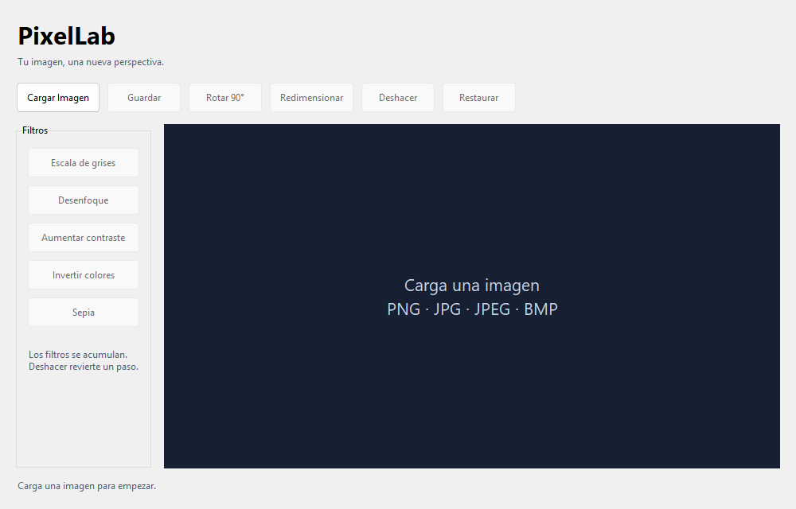
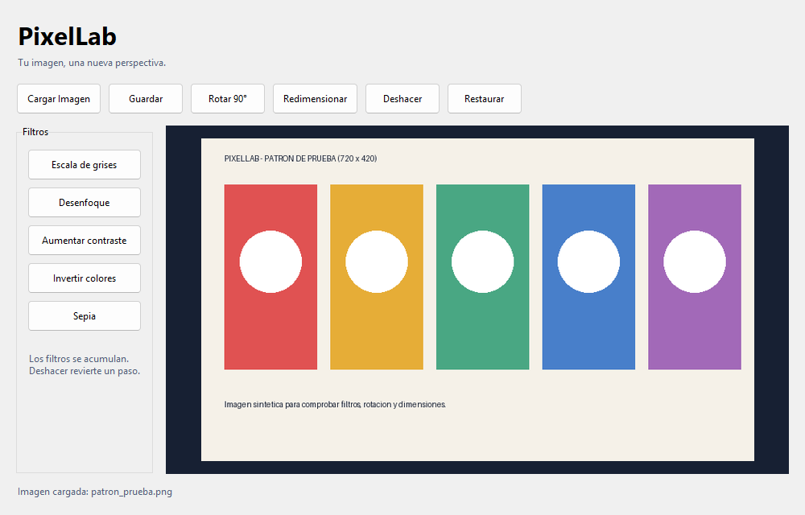
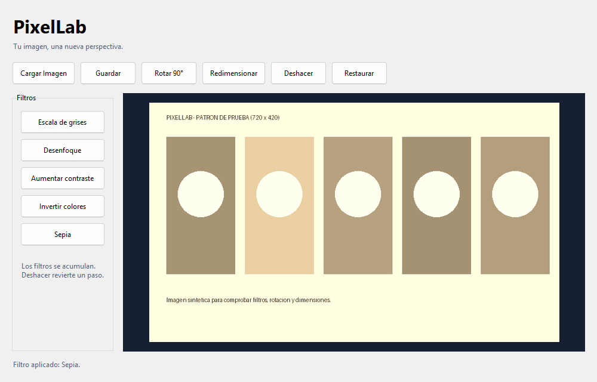
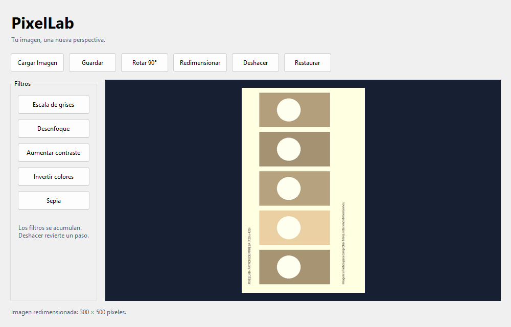

# Informe Técnico – PixelLab

**Proyecto:** PixelLab, editor de imágenes de escritorio
**Asignatura:** Programación Orientada a Objetos (Parcial Integrador)
**Autores:** Anderson Areiza, Cristian Sarmiento, Yeyner Florez
**Repositorio:** https://github.com/areizaanderson1779-coder/PixelLab
**Entorno de verificación:** Windows, Python 3.14.10, Pillow 13.0.0 (16 de noviembre de 2026)
**Versión mínima de Python:** 3.10

Diagramas: ver [DIAGRAMAS.md](DIAGRAMAS.md).

---

## 1. Análisis del problema

### 1.1 Necesidad
Ediciones básicas como un filtro, una rotación, un cambio de tamaño o volver atrás suelen hacerse con programas de propósito general, extensos para tareas tan simples. Se planteó una aplicación de escritorio liviana que resolviera esas operaciones con vista previa y con la posibilidad de deshacer.

### 1.2 Público objetivo
Usuarios que necesitan ediciones rápidas y sencillas sin conocimientos de herramientas profesionales, y estudiantes que quieran ver un ejemplo de aplicación gráfica organizada con POO.

### 1.3 Alcance
- Abrir imágenes PNG, JPG, JPEG y BMP.
- Aplicar cinco filtros acumulativos: escala de grises, desenfoque, aumento de contraste, inversión de colores y sepia.
- Rotar 90° en sentido antihorario sin recortar.
- Redimensionar con un ancho y un alto validados.
- Deshacer cambios sucesivos y restaurar la imagen original.
- Exportar a PNG, JPEG o BMP.
- Informar los errores previsibles sin perder la sesión.

### 1.4 Limitaciones
- No hay rehacer, capas, recorte, filtro de brillo, deslizadores de parámetros ni procesamiento por lotes.
- El desenfoque usa un radio fijo de 2 y el contraste un factor fijo de 1.5.
- No hay base de datos y la sesión no se conserva al cerrar.
- No se avisa de cambios sin guardar al cerrar o al cargar otra imagen. Cargar una imagen nueva vacía el historial.
- El historial guarda copias completas, con el consumo de memoria que eso implica.
- Las operaciones son síncronas en el hilo de Tkinter: con imágenes grandes la ventana puede pausarse momentáneamente.
- Redimensionar no conserva la proporción automáticamente.
- Guardar no reemplaza la imagen original que usa *Restaurar*.

---

## 2. Diseño inicial

Se identificaron tres responsabilidades diferentes y se asignó cada una a clases distintas:

| Clase | Responsabilidad |
|---|---|
| `Filtro` (abstracta) | Define el contrato común de una transformación: tener un nombre y poder `aplicar()` sobre una imagen. |
| `FiltroGrises`, `FiltroDesenfoque`, `FiltroContraste`, `FiltroInvertir`, `FiltroSepia` | Implementar cada una su propia transformación. |
| `EditorImagen` | Administrar el estado de la imagen (original, actual, historial y ruta), validar las operaciones, cargar y exportar. |
| `VentanaPrincipal` | Gestionar la interacción gráfica: controles, eventos, diálogos, vista previa y mensajes. |

Nombre que cada filtro entrega a `super().__init__()`:

| Clase | Nombre | Operación de Pillow |
|---|---|---|
| `FiltroGrises` | "Escala de grises" | `ImageOps.grayscale()`, con el resultado convertido a RGB |
| `FiltroDesenfoque` | "Desenfoque" | `ImageFilter.GaussianBlur(radius=2)` |
| `FiltroContraste` | "Aumentar contraste" | `ImageEnhance.Contrast(...).enhance(1.5)` |
| `FiltroInvertir` | "Invertir colores" | `ImageOps.invert()` |
| `FiltroSepia` | "Sepia" | Conversión RGB con una matriz sepia |

Matriz usada por `FiltroSepia`:

```
0.393, 0.769, 0.189, 0
0.349, 0.686, 0.168, 0
0.272, 0.534, 0.131, 0
```

Todos los filtros conservan el canal alfa mediante `Filtro._conservar_alfa(original, resultado)`.

---

## 3. Arquitectura

### 3.1 Organización

```
main.py  ──►  interfaz/ventana_principal.py  ──►  modelos/editor.py
                          │                              │
                          └──────►  modelos/filtros.py ◄─┘ (uso por parámetro)
```

- **`modelos/`**: lógica del dominio. No importa Tkinter, por eso se puede probar con `unittest` sin abrir ventanas.
- **`interfaz/`**: presentación. Depende de `modelos/`, pero `modelos/` no depende de ella.
- **`main.py`**: punto de entrada. Dentro de `if __name__ == "__main__":` crea `VentanaPrincipal()` y ejecuta `ventana.mainloop()`.

La arquitectura **separa el modelo de la presentación**, pero **no es un MVC completo**: no existe un controlador independiente. `VentanaPrincipal` atiende los eventos y llama directamente al modelo.

### 3.2 Comunicación
1. El usuario pulsa un control de `VentanaPrincipal`.
2. El callback del control llama a `_ejecutar(accion, mensaje)`.
3. `_ejecutar` invoca el método correspondiente de `EditorImagen`.
4. Si la operación termina bien, la ventana actualiza la etiqueta de estado y la vista previa con `_mostrar_imagen()`.
5. Si el modelo lanza `ValueError`, `OSError` o `MemoryError`, la ventana muestra `messagebox.showerror`. Las validaciones y los casos de carga o filtro fallidos probados conservan el estado anterior; no se garantiza una recuperación atómica ante agotamiento de memoria.

---

## 4. Aplicación de la Programación Orientada a Objetos

### 4.1 Tabla de conceptos

| Concepto | Clase o método | Archivo | Explicación |
|---|---|---|---|
| Clases y objetos | `EditorImagen`, `Filtro` y subclases, `VentanaPrincipal` | `modelos/editor.py`, `modelos/filtros.py`, `interfaz/ventana_principal.py` | Cada clase modela una responsabilidad. En ejecución, la ventana es un objeto que contiene un objeto editor y una lista de objetos filtro. |
| Constructores | `Filtro.__init__(nombre)`, `EditorImagen.__init__()`, `VentanaPrincipal.__init__(filtros=None)` | Los tres archivos | Inicializan el estado: el nombre validado del filtro; las imágenes y la ruta en `None` con el historial vacío; el editor y la lista de filtros de la ventana. |
| Encapsulamiento | `_imagen_original`, `_imagen_actual`, `_historial`, `_ruta_actual` y las propiedades `tiene_imagen`, `imagen_actual`, `ruta_actual` | `modelos/editor.py` | El estado se guarda en atributos internos con guion bajo y se expone con propiedades sin setter público. En Python el guion bajo indica privacidad **por convención**: no impide el acceso, pero señala que el estado solo debe modificarse mediante los métodos del editor. |
| Encapsulamiento (copia defensiva) | Propiedad `imagen_actual` | `modelos/editor.py` | Devuelve una **copia**: modificarla no altera la imagen interna. Lo verifica una prueba. |
| Encapsulamiento (validación) | `_exigir_imagen()`, `redimensionar()`, `cargar()`, `guardar()`, `Filtro.__init__` | `modelos/editor.py`, `modelos/filtros.py` | Rechazan operaciones sin imagen, dimensiones no enteras (incluido `bool`) o fuera de rango, extensiones no admitidas y nombres de filtro vacíos o que no sean texto. La carga decodifica la imagen antes de reemplazar el estado, de modo que un fallo conserva la sesión. |
| Encapsulamiento (propiedad de solo lectura) | `Filtro.nombre` | `modelos/filtros.py` | El nombre se valida una sola vez en el constructor y no tiene setter público. |
| Herencia | `Filtro(ABC)` y sus cinco subclases | `modelos/filtros.py` | Cada filtro hereda `_nombre`, `nombre` y `_conservar_alfa`, y llama a `super().__init__("<nombre>")` para reutilizar la validación del nombre. No añade atributos propios. |
| Herencia | `VentanaPrincipal(tk.Tk)` | `interfaz/ventana_principal.py` | La ventana **es** una ventana Tkinter. Llama a `super().__init__()` antes de construir sus controles. |
| Polimorfismo | `EditorImagen.aplicar_filtro(filtro)` → `filtro.aplicar(...)` | `modelos/editor.py`, `modelos/filtros.py` | El editor llama a `aplicar()` sin conocer la clase concreta y sin usar `if` por tipo. Cada subclase responde con una operación distinta. Una prueba con un filtro externo que produce azul confirma que se pueden agregar filtros sin modificar el editor. |
| Abstracción | `Filtro(ABC)` con `@abstractmethod aplicar(imagen)` | `modelos/filtros.py` | Define qué debe hacer un filtro sin decir cómo. `Filtro` no se puede instanciar directamente (genera `TypeError`, comprobado en las pruebas). |
| Relación: composición | `VentanaPrincipal.editor = EditorImagen()` | `interfaz/ventana_principal.py` | La ventana crea y administra su propio editor. Es composición en el diseño; Python no impone una destrucción inmediata del objeto al cerrar la ventana. |
| Relación: agregación | `VentanaPrincipal.filtros` | `interfaz/ventana_principal.py` | La ventana mantiene una lista de filtros. Puede recibirlos ya creados desde fuera (`filtros`) o, si recibe `None`, crear los cinco incluidos. Los filtros no dependen de la ventana para existir. |
| Relación: dependencia de uso | `EditorImagen.aplicar_filtro(filtro)` | `modelos/editor.py` | El editor recibe el filtro **solo como parámetro** durante la llamada y no lo almacena. Es una dependencia temporal, no una asociación persistente. |

La composición y la agregación son formas de asociación. Solo se describen las relaciones que existen en el código.

### 4.2 Fragmentos que aclaran el diseño

Contrato abstracto de los filtros (esquema de `modelos/filtros.py`):

```python
class Filtro(ABC):
    def __init__(self, nombre: str):
        # Valida que sea str y no esté vacío ni formado solo por espacios.
        # Si es inválido -> ValueError. Guarda nombre.strip().
        ...

    @property
    def nombre(self) -> str:
        return self._nombre

    @abstractmethod
    def aplicar(self, imagen: Image.Image) -> Image.Image:
        ...
```

Polimorfismo y protección del estado en `EditorImagen.aplicar_filtro` (esquema):

```python
imagen = self._exigir_imagen()               # ValueError si no hay imagen
resultado = filtro.aplicar(imagen.copy())    # el filtro trabaja sobre una copia
if not isinstance(resultado, Image.Image):
    raise ValueError("El filtro debe devolver una imagen válida.")
self._registrar_cambio(resultado)            # historial + nueva imagen actual
```

Los fragmentos son esquemas que resumen el código. La implementación completa está en los archivos indicados.

### 4.3 Comportamiento del historial

| Operación | Efecto sobre el historial |
|---|---|
| `aplicar_filtro`, `rotar`, `redimensionar`, `restaurar` | `_registrar_cambio` guarda una copia del estado anterior. Se puede deshacer. |
| `deshacer` | Recupera el último estado con `pop()`. Si está vacío, lanza `ValueError("No hay cambios para deshacer.")`. |
| `cargar` | Si la carga es correcta, reemplaza el original y la imagen actual y **vacía** el historial. Si falla la validación o la decodificación, se conserva el estado anterior. |
| `guardar` | No modifica el historial ni el original. Escribe el archivo y, si tiene éxito, actualiza `ruta_actual`. |

---

## 5. Bibliotecas utilizadas

### 5.1 Pillow (externa)
- **Qué resuelve:** lectura, transformación y escritura de imágenes.
- **Por qué se usa:** ofrece directamente las operaciones necesarias (`ImageOps`, `ImageFilter`, `ImageEnhance`, rotación, `Resampling.LANCZOS`, exportación y `ImageTk`) y se integra como llamadas dentro de los métodos de las clases.
- **Instalación:** `pip install -r requirements.txt` (contenido: `Pillow>=10.0.0`). Se instala en el entorno de Python activo.
- **Dónde se usa:**
  - `modelos/filtros.py`: efectos y conversiones de los cinco filtros.
  - `modelos/editor.py`: carga, corrección de orientación (`ImageOps.exif_transpose`), rotación, redimensionado y exportación.
  - `interfaz/ventana_principal.py`: vista previa con `ImageTk.PhotoImage`.
  - `tests/`: creación de imágenes de prueba y verificación de resultados. `verificar_interfaz.py` usa además `ImageDraw` para el patrón e `ImageGrab` para las capturas.

### 5.2 Tkinter (biblioteca estándar)
- **Qué resuelve:** ventana, controles, eventos y diálogos.
- **Por qué se usa:** viene con Python, así que no hace falta otra dependencia externa para la interfaz.
- **Instalación:** no se instala con pip. Se comprueba con `python -m tkinter`. En algunas distribuciones de Linux requiere el paquete del sistema `python3-tk`.

Las demás bibliotecas usadas pertenecen a la biblioteca estándar: `abc`, `pathlib`, `collections.abc`, `unittest`, `unittest.mock`, `tempfile`, `argparse`, `sys` y `time`.

---

## 6. Construcción de la interfaz

### 6.1 Diseño y controles
`VentanaPrincipal` hereda de `tk.Tk` y usa widgets de `tkinter` y `ttk`:
- Título **PixelLab**.
- Botones **Cargar Imagen**, **Guardar**, **Rotar 90°**, **Redimensionar**, **Deshacer** y **Restaurar**.
- Panel lateral con un botón por cada filtro de la lista `filtros`.
- `Canvas` (`_lienzo`) para la vista previa.
- Etiqueta de estado (`_estado`).
- `filedialog` para abrir y guardar, `simpledialog.askinteger` para el ancho y el alto, y `messagebox.showerror` para los errores.

### 6.2 Métodos de la ventana

| Método | Función |
|---|---|
| `_crear_controles()` | Construye los botones, el panel de filtros, el lienzo y la etiqueta de estado. |
| `_actualizar_controles()` | Deshabilita los botones de edición (`_botones_edicion`) cuando no hay imagen. *Deshacer* puede quedar habilitado con imagen y sin historial; al pulsarlo se muestra el error correspondiente. |
| `_ejecutar(accion, mensaje)` | Llama al modelo, captura `ValueError`, `OSError` y `MemoryError`, y actualiza el estado y la vista. |
| `_cargar()` / `_guardar()` | Abren el selector de archivos y llaman a `editor.cargar()` o `editor.guardar()`. |
| `_redimensionar()` | Pide primero el ancho y después el alto, cada uno limitado a 1–10000. Si se cancela cualquiera de los dos, la imagen queda intacta. El límite total de píxeles lo valida el modelo. |
| `_al_redimensionar(evento)` | Atiende el evento `<Configure>` y programa un redibujado con `after(100, ...)` (control en `_redibujado`). |
| `_mostrar_imagen()` | Aplica `thumbnail` a una **copia** de la imagen, crea un `ImageTk.PhotoImage` y conserva su referencia en `self._foto`. |

### 6.3 Eventos y callbacks
- Cada botón de filtro se conecta con `lambda f=filtro: ...`. El argumento por defecto fija el objeto filtro de esa iteración del bucle. Sin él, todos los botones usarían el último filtro.
- El evento `<Configure>` (cambio de tamaño de la ventana) adapta la vista previa sin tocar la imagen del modelo.

### 6.4 Separación de responsabilidades
La ventana **no** contiene lógica de filtros, historial, rotación, redimensionado ni exportación: todo eso está en `EditorImagen` y en los filtros. La ventana solo traduce eventos en llamadas al modelo y muestra el resultado.

Hay que distinguir dos operaciones. **Redimensionar** cambia las dimensiones reales de la imagen del modelo. **Escalar la vista previa** (`thumbnail` sobre una copia) solo adapta lo que se ve en pantalla y no afecta al archivo guardado.

### 6.5 Capturas
Son capturas reales de la ventana de Tkinter tomadas con `ImageGrab` mediante `python tests/verificar_interfaz.py --capturas`. La imagen cargada es `recursos/patron_prueba.png`, un patrón sintético de 720×420 creado para pruebas; no es una fotografía.

**Ventana inicial**



**Imagen cargada**



**Filtro sepia aplicado**



**Imagen rotada y redimensionada a 300×500**



---

## 7. Proceso de desarrollo

Etapas observables del proyecto:

1. **Definición del alcance** del editor: operaciones básicas con deshacer y exportación.
2. **Separación de responsabilidades** en filtros, estado del editor y ventana.
3. **Implementación** de los cinco filtros y de las operaciones de edición.
4. **Integración de callbacks** entre la ventana y el modelo.
5. **Pruebas** del modelo y de la interfaz.
6. **Incorporación posterior** del redimensionado validado y de la validación de nombres de filtros.
7. **Capturas reales** y publicación en GitHub.

Commits de implementación y evidencias anteriores a esta actualización documental:

| Commit | Mensaje |
|---|---|
| `1c68eff` | feat: agregar redimensionado validado y validar nombres de filtros |
| `6227686` | test: verificar botones y manejo de errores de la interfaz |
| `fc9039e` | test: agregar capturas reales y patron de prueba |

---

## 8. Pruebas

### 8.1 Tipos de verificación
- **Pruebas del modelo:** `python -m unittest discover -s tests -v`. Resultado: **18 pruebas aprobadas**.
- **Integración de la interfaz:** `python tests/verificar_interfaz.py`. Usa Tkinter real, botones reales invocados por programa, el editor real e imágenes reales. Los selectores de archivo y de números se controlan con `unittest.mock`, y para verificar el error también se intercepta `messagebox.showerror`. **No** es una prueba manual de todos los diálogos nativos.
- **Arranque:** se ejecutó `python main.py`. La aplicación permaneció activa cuatro segundos sin errores de arranque y luego se cerró el proceso de prueba.
- **Compilación:** `main.py` y los módulos de `modelos/` e `interfaz/` compilaron correctamente.

### 8.2 Casos representativos

| Prueba | Acción realizada | Resultado esperado | Resultado obtenido |
|---|---|---|---|
| Modelo: redimensionar y deshacer | Redimensionar una imagen de 3×2 a 12×8 y luego deshacer | 12×8 tras redimensionar y 3×2 tras deshacer | Correcto: 12×8 y luego 3×2 |
| Modelo: dimensiones inválidas (error) | Redimensionar con (0,4), (-1,4), (2.5,4), (True,4), (4,"2") y (10001,1) | `ValueError` en cada caso, la imagen sigue en 3×2 y no se añade historial | `ValueError` en todos los casos, 3×2 conservado y sin historial nuevo |
| Modelo: operaciones sin imagen (error) | Aplicar filtro, rotar, restaurar, deshacer, guardar y redimensionar sin imagen cargada | `ValueError` | `ValueError` en todas las operaciones |
| Modelo: carga fallida | Cargar una ruta inexistente con una imagen ya cargada | Se conservan la imagen y la ruta anteriores | Imagen y ruta anteriores conservadas |
| Modelo: inversión y deshacer | Invertir un píxel (100,150,200,128) y deshacer | (155,105,55,128) y luego el valor original | (155,105,55,128) y original recuperado |
| Modelo: rotación, restauración y deshacer | Rotar 3×2, restaurar y deshacer la restauración | 2×3, luego 3×2, luego 2×3 | 2×3, 3×2 y 2×3 |
| Modelo: polimorfismo | Aplicar un filtro externo de prueba que produce azul | Imagen azul sin modificar `EditorImagen` | Imagen azul obtenida |
| Modelo: filtro defectuoso (error) | Aplicar un filtro que modifica su copia y falla | La imagen interna no cambia y no se añade historial | Imagen interna intacta y sin historial nuevo |
| Filtros: valores de color | Aplicar escala de grises y sepia a un rojo puro | Grises (76,76,76) y sepia (100,89,69) | (76,76,76) y (100,89,69) |
| Filtros: abstracción | Instanciar `Filtro` directamente | `TypeError` | `TypeError` |
| Integración GUI | Invocar por programa los botones: cargar, cinco filtros, rotar, redimensionar, guardar, deshacer y restaurar. Cancelar el redimensionado. Intentar una carga inválida | Cada operación actualiza la imagen. Cancelar no cambia nada. La carga inválida solicita un aviso de error y conserva la imagen. El archivo exportado tiene las dimensiones esperadas | Todo verificado sin errores funcionales pendientes |
| Arranque | Ejecutar `python main.py` | La ventana inicia sin errores | Activa 4 segundos sin errores de arranque |

### 8.3 Lista completa de las 18 pruebas del modelo
1. Redimensionar 3×2 a 12×8 y deshacer recupera 3×2.
2. Dimensiones inválidas generan `ValueError`, conservan 3×2 y no añaden historial.
3. Redimensionar sin imagen genera `ValueError`.
4. Aplicar filtro, rotar, restaurar, deshacer y guardar sin imagen generan `ValueError`.
5. Modificar la copia de `imagen_actual` no cambia el estado interno.
6. Invertir (100,150,200,128) produce (155,105,55,128) y deshacer recupera el original.
7. Rotar 3×2 produce 2×3, restaurar vuelve a 3×2 y deshacer la restauración vuelve a 2×3.
8. Deshacer sin historial genera `ValueError`.
9. Cargar una ruta inexistente conserva la imagen y la ruta anteriores.
10. Cargar y guardar PNG, JPG, JPEG y BMP produce archivos legibles con las mismas dimensiones.
11. Exportar RGBA a JPEG produce RGB y el modelo se mantiene en RGBA.
12. Un filtro externo de prueba produce azul sin modificar el editor.
13. Un filtro que modifica su copia y falla no cambia la imagen interna ni añade historial.
14. Nombres vacíos, con solo espacios, `None` o numéricos generan `ValueError`, y se recortan los espacios de un nombre válido.
15. Instanciar `Filtro` directamente genera `TypeError`.
16. Rojo puro produce grises (76,76,76) y sepia (100,89,69).
17. Los cinco filtros conservan el canal alfa y no modifican la imagen recibida.
18. El desenfoque suaviza un punto claro y el contraste lo acentúa.

---

## 9. Problemas y soluciones

### 9.1 Problemas observados durante el desarrollo

| Problema | Diagnóstico | Solución |
|---|---|---|
| Una prueba de sepia fallaba en el canal verde | La prueba esperaba 88, pero el cálculo es 255 × 0.349 = 88.995 y Pillow redondea a **89**. El error estaba en la expectativa de la prueba, no en el filtro. | Se corrigió el valor esperado en la prueba y se volvió a ejecutar la suite completa, con resultado aprobado. |
| Tkinter no encontraba `init.tcl` en el entorno de verificación | Se usaba una copia reubicada de Python cuyos archivos Tcl/Tk no estaban donde Tkinter los buscaba. **No era un defecto de PixelLab.** | Se localizaron los archivos Tcl/Tk de esa copia, se extrajeron y se configuraron `TCL_LIBRARY` y `TK_LIBRARY` solo para ese entorno. No es un paso de instalación habitual para el usuario. |

### 9.2 Riesgos previstos y resueltos por diseño
Estos puntos no necesariamente causaron fallos durante el desarrollo: son riesgos técnicos que el diseño evita.

| Riesgo | Solución aplicada |
|---|---|
| JPEG no admite canal alfa | Al exportar a JPEG o BMP se compone una copia sobre fondo RGB blanco. El modelo conserva su versión RGBA. |
| Tkinter pierde la imagen si no se conserva la referencia al `PhotoImage` | La referencia se guarda en `self._foto`. |
| Los callbacks creados en un bucle pueden capturar solo el último filtro | Se usa `lambda f=filtro:` para fijar cada objeto. |
| Escalar la vista previa podría alterar la exportación | `thumbnail` se aplica a una copia, nunca a la imagen del modelo. |
| Una carga fallida podría destruir la sesión | La imagen se decodifica completamente antes de reemplazar el estado. |
| Un filtro defectuoso podría corromper el estado | El filtro recibe `imagen.copy()` y el editor verifica que el resultado sea `Image.Image`. |
| Dimensiones inválidas | Doble validación: los diálogos limitan a 1–10000 y `EditorImagen` valida el tipo, el rango y el límite de 25.000.000 de píxeles. |

---

## 10. Conclusiones y mejoras futuras

### 10.1 Conclusiones
- La **abstracción** (`Filtro` con `@abstractmethod`) y el **polimorfismo** (`filtro.aplicar(...)`) permiten agregar filtros nuevos sin modificar `EditorImagen`, como demuestra la prueba con un filtro externo.
- El **encapsulamiento** tiene una función real: las propiedades sin setter, la copia defensiva y las validaciones protegen el estado, y los casos de entradas inválidas y filtros fallidos probados conservan la sesión.
- La **herencia** con `super()` reutiliza la validación del nombre en los filtros y el comportamiento de ventana de `tk.Tk`.
- La **composición** (ventana–editor), la **agregación** (ventana–filtros) y la **dependencia de uso** (editor–filtro) describen las relaciones que realmente existen entre los objetos.
- Separar el modelo de la interfaz permitió probar la lógica con 18 pruebas automatizadas y verificar la interfaz con una prueba de integración.

### 10.2 Posibles mejoras futuras (NO implementadas)
- Opción de rehacer.
- Opción de mantener la proporción al redimensionar.
- Aviso de cambios sin guardar al cerrar o al cargar otra imagen.
- Parámetros ajustables (radio del desenfoque, factor de contraste) y un filtro de brillo.
- Límite de tamaño del historial para reducir el consumo de memoria.
- Procesar las imágenes grandes fuera del hilo de Tkinter para que la ventana no se pause.
